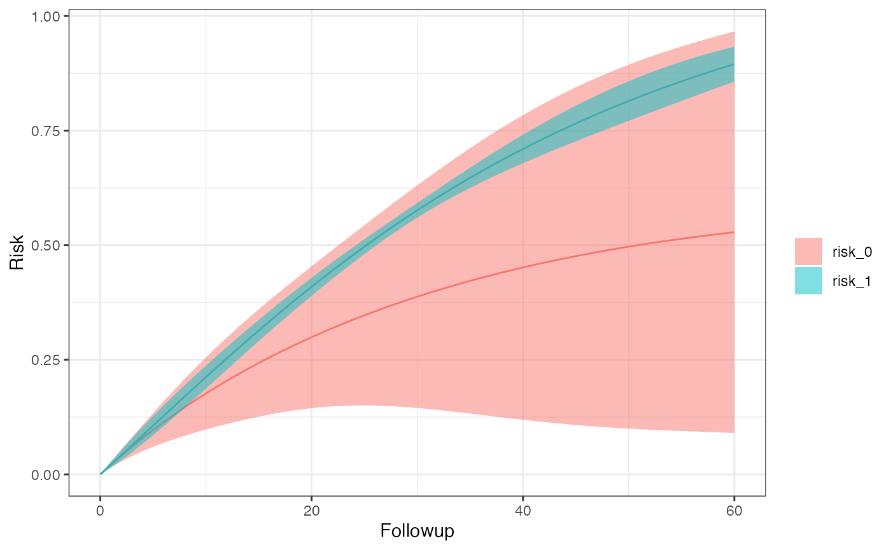
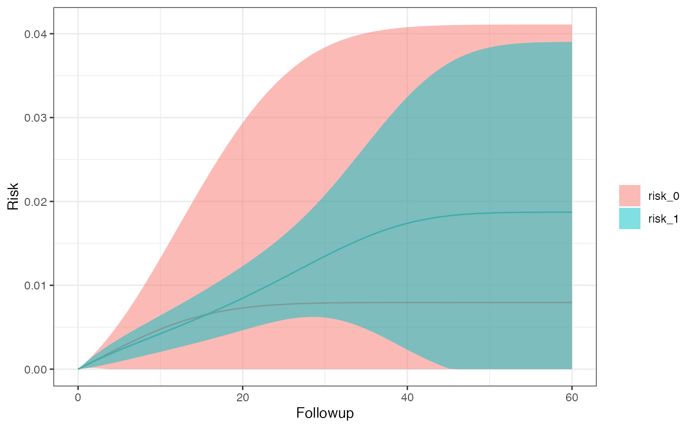
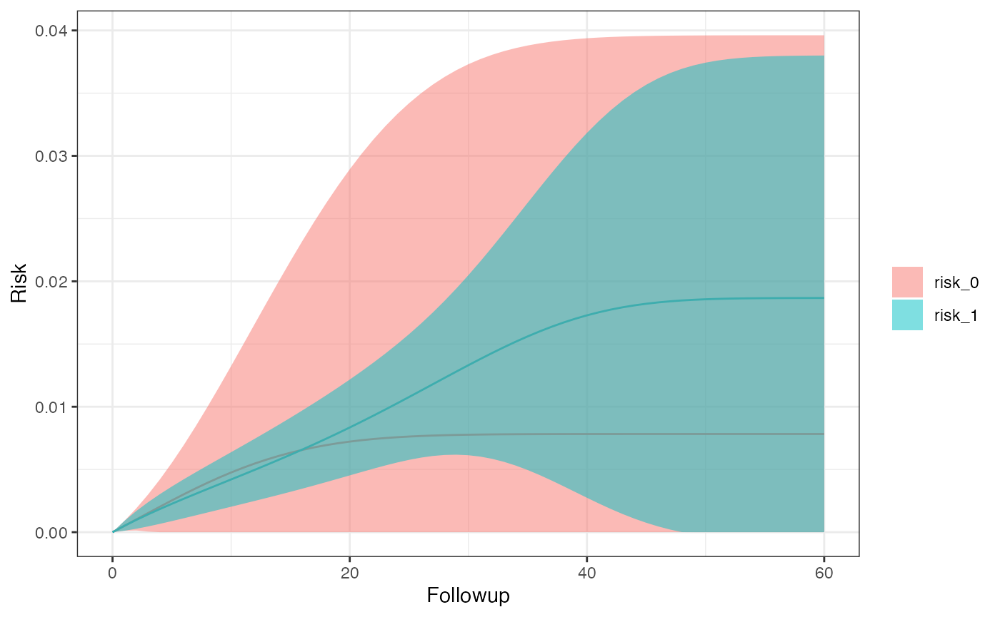
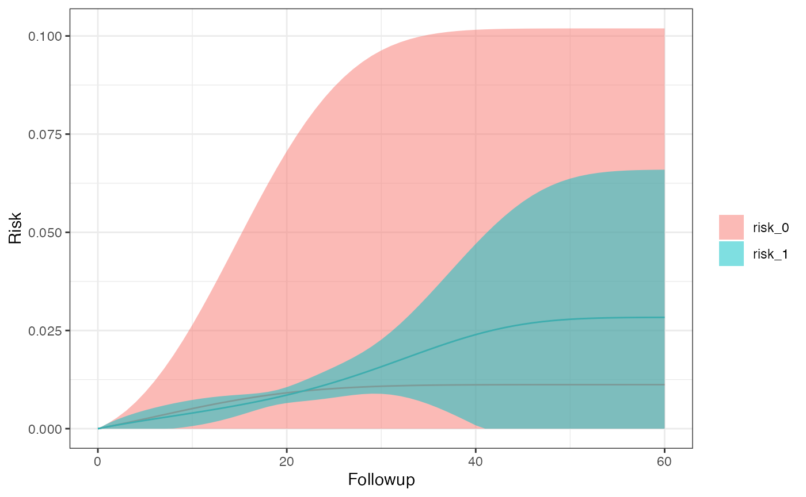
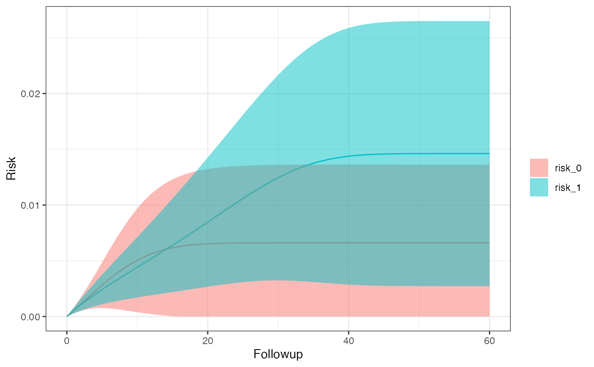

# Per-Protocol: Dose-Response Analysis

Here, we’ll go over some examples of using dose-response. First we need
to load the library before getting in to some sample use cases.

``` r

library(SEQTaRget)
```

Currently, dose-response analysis through SEQuential only supports
binary treatment values. Therefore; running multinomial models will lead
to errors.

## Dose-response With 5 bootstrap samples

``` r

options <- SEQopts(# tells SEQuential to create Kaplan-Meier curves
                   km.curves = TRUE,
                   # tells SEQuential to bootstrap
                   bootstrap = TRUE,
                   seed = 1636,
                   # tells SEQuential to run bootstraps 5 times
                   bootstrap.nboot = 5)

# use example data
data <- SEQdata                             
model <- SEQuential(data, id.col = "ID", 
                          time.col = "time", 
                          eligible.col = "eligible", 
                          treatment.col = "tx_init", 
                          outcome.col = "outcome", 
                          time_varying.cols = c("N", "L", "P"), 
                          fixed.cols = "sex",
                          method = "dose-response", 
                          options = options)
#> 
#> Full dataset: 12,180 observations, 11 variables
#> 
#> Non-required columns provided, pruning for efficiency
#> 
#> Pruned
#> 
#> Original dataset (eligible subjects): 9,203 observations, 9 variables
#> 
#> Expanding Data...
#> 
#> Pre-filter expansion: 310,080 observations
#> 
#> Expanded dataset: 248,485 observations, 15 variables
#> 
#> Expansion Successful
#> 
#> Final analysis dataset: 248,485 observations, 15 variables
#> 
#> Moving forward with dose-response analysis
#> Warning: Cholesky factorization is singular or ill-conditioned; the model was
#> fit with pivoted QR (method = 0) instead.
#> 
#> Bootstrapping with 80% of 300 subjects (240 subjects, ~198,788 observations per resample) 5 times
#> Warning: Cholesky factorization is singular or ill-conditioned; the model was
#> fit with pivoted QR (method = 0) instead.
#> Warning: Cholesky factorization is singular or ill-conditioned; the model was
#> fit with pivoted QR (method = 0) instead.
#> Warning: Cholesky factorization is singular or ill-conditioned; the model was
#> fit with pivoted QR (method = 0) instead.
#> Warning: Cholesky factorization is singular or ill-conditioned; the model was
#> fit with pivoted QR (method = 0) instead.
#> Warning: Cholesky factorization is singular or ill-conditioned; the model was
#> fit with pivoted QR (method = 0) instead.
#> 
#> dose-response model created successfully
#> 
#> Creating Survival curves
#> 
#> Completed

km_curve(model, plot.type = "risk")        # retrieve risk plot
```



``` r

risk_data(model)
#> Index: <Followup>
#>           Method Followup      A      Risk    95% LCI   95% UCI         SE
#>           <char>    <num> <char>     <num>      <num>     <num>      <num>
#> 1: dose-response       60      0 0.5282782 0.09021852 0.9663379 0.22350395
#> 2: dose-response       60      1 0.8949096 0.85678926 0.9330300 0.01944951
risk_comparison(model)
#>    Followup    A_x    A_y Risk Ratio RR 95% LCI RR 95% UCI log(RR) SE
#>       <num> <fctr> <fctr>      <num>      <num>      <num>      <num>
#> 1:       60 risk_0 risk_1  1.6940120  0.8283692   3.464248  0.3650047
#> 2:       60 risk_1 risk_0  0.5903146  0.2886629   1.207191  0.3650047
#>    Risk Difference  RD 95% LCI RD 95% UCI    RD SE
#>              <num>       <num>      <num>    <num>
#> 1:       0.3666314 -0.05833181 0.79159462 0.216822
#> 2:      -0.3666314 -0.79159462 0.05833181 0.216822
```

## Dose-response with 5 bootstrap samples and losses-to-followup

``` r

options <- SEQopts(km.curves = TRUE,               
                   bootstrap = TRUE,                
                   seed = 1636,
                   bootstrap.nboot = 5,
                   # tells SEQuential to expect LTFU as the censoring column
                   cense = "LTFU",
                   # tells SEQuential to treat this column as the 
                   # censoring eligibility column
                   cense.eligible = "eligible_cense")

# use example data for LTFU
data <- SEQdata.LTFU
model <- SEQuential(data, id.col = "ID", 
                          time.col = "time", 
                          eligible.col = "eligible", 
                          treatment.col = "tx_init", 
                          outcome.col = "outcome", 
                          time_varying.cols = c("N", "L", "P"), 
                          fixed.cols = "sex",
                          method = "dose-response", 
                          options = options)
#> 
#> Full dataset: 54,687 observations, 13 variables
#> 
#> Non-required columns provided, pruning for efficiency
#> 
#> Pruned
#> 
#> Original dataset (eligible subjects): 29,624 observations, 11 variables
#> 
#> Expanding Data...
#> 
#> Pre-filter expansion: 1,609,859 observations
#> 
#> Expanded dataset: 1,119,229 observations, 17 variables
#> 
#> Expansion Successful
#> 
#> Final analysis dataset: 1,119,229 observations, 17 variables
#> 
#> Moving forward with dose-response analysis
#> 
#> Bootstrapping with 80% of 1,000 subjects (800 subjects, ~895,383 observations per resample) 5 times
#> 
#> dose-response model created successfully
#> 
#> Creating Survival curves
#> 
#> Completed

km_curve(model, plot.type = "risk")
```



``` r

risk_data(model)
#> Index: <Followup>
#>           Method Followup      A        Risk 95% LCI    95% UCI         SE
#>           <char>    <num> <char>       <num>   <num>      <num>      <num>
#> 1: dose-response       60      0 0.007952468       0 0.04110160 0.01691313
#> 2: dose-response       60      1 0.018718195       0 0.03902605 0.01036134
risk_comparison(model)
#>    Followup    A_x    A_y Risk Ratio RR 95% LCI RR 95% UCI log(RR) SE
#>       <num> <fctr> <fctr>      <num>      <num>      <num>      <num>
#> 1:       60 risk_0 risk_1  2.3537592 0.27154127  20.402727   1.101885
#> 2:       60 risk_1 risk_0  0.4248523 0.04901306   3.682681   1.101885
#>    Risk Difference  RD 95% LCI RD 95% UCI      RD SE
#>              <num>       <num>      <num>      <num>
#> 1:      0.01076573 -0.01513927 0.03667072 0.01321708
#> 2:     -0.01076573 -0.03667072 0.01513927 0.01321708
```

## Dose-response with 5 bootstrap samples and competing events

``` r

options <- SEQopts(km.curves = TRUE,               
                   bootstrap = TRUE,                
                   seed = 1636,
                   bootstrap.nboot = 5,
                   # Using LTFU as our competing event
                   compevent = "LTFU")

data <- SEQdata.LTFU
model <- SEQuential(data, id.col = "ID", 
                          time.col = "time", 
                          eligible.col = "eligible", 
                          treatment.col = "tx_init", 
                          outcome.col = "outcome", 
                          time_varying.cols = c("N", "L", "P"), 
                          fixed.cols = "sex",
                          method = "dose-response", 
                          options = options)
#> 
#> Full dataset: 54,687 observations, 13 variables
#> 
#> Non-required columns provided, pruning for efficiency
#> 
#> Pruned
#> 
#> Original dataset (eligible subjects): 29,624 observations, 10 variables
#> 
#> Expanding Data...
#> 
#> Pre-filter expansion: 1,609,859 observations
#> 
#> Expanded dataset: 1,119,229 observations, 16 variables
#> 
#> Expansion Successful
#> 
#> Final analysis dataset: 1,119,229 observations, 16 variables
#> 
#> Moving forward with dose-response analysis
#> Warning: Cholesky factorization is singular or ill-conditioned; the model was
#> fit with pivoted QR (method = 0) instead.
#> 
#> Bootstrapping with 80% of 1,000 subjects (800 subjects, ~895,383 observations per resample) 5 times
#> Warning: Cholesky factorization is singular or ill-conditioned; the model was
#> fit with pivoted QR (method = 0) instead.
#> Warning: Cholesky factorization is singular or ill-conditioned; the model was
#> fit with pivoted QR (method = 0) instead.
#> Warning: Cholesky factorization is singular or ill-conditioned; the model was
#> fit with pivoted QR (method = 0) instead.
#> Warning: Cholesky factorization is singular or ill-conditioned; the model was
#> fit with pivoted QR (method = 0) instead.
#> Warning: Cholesky factorization is singular or ill-conditioned; the model was
#> fit with pivoted QR (method = 0) instead.
#> 
#> dose-response model created successfully
#> 
#> Creating Survival curves
#> Warning: Cholesky factorization is singular or ill-conditioned; the model was
#> fit with pivoted QR (method = 0) instead.
#> Warning: prediction is not estimable for some rows of the rank-deficient design
#> Warning: prediction is not estimable for some rows of the rank-deficient design
#> Warning: Cholesky factorization is singular or ill-conditioned; the model was
#> fit with pivoted QR (method = 0) instead.
#> Warning: prediction is not estimable for some rows of the rank-deficient design
#> Warning: prediction is not estimable for some rows of the rank-deficient design
#> Warning: Cholesky factorization is singular or ill-conditioned; the model was
#> fit with pivoted QR (method = 0) instead.
#> Warning: prediction is not estimable for some rows of the rank-deficient design
#> Warning: prediction is not estimable for some rows of the rank-deficient design
#> Warning: Cholesky factorization is singular or ill-conditioned; the model was
#> fit with pivoted QR (method = 0) instead.
#> Warning: prediction is not estimable for some rows of the rank-deficient design
#> Warning: prediction is not estimable for some rows of the rank-deficient design
#> Warning: Cholesky factorization is singular or ill-conditioned; the model was
#> fit with pivoted QR (method = 0) instead.
#> Warning: prediction is not estimable for some rows of the rank-deficient design
#> Warning: prediction is not estimable for some rows of the rank-deficient design
#> Warning: Cholesky factorization is singular or ill-conditioned; the model was
#> fit with pivoted QR (method = 0) instead.
#> Warning: prediction is not estimable for some rows of the rank-deficient design
#> Warning: prediction is not estimable for some rows of the rank-deficient design
#> 
#> Completed

km_curve(model, plot.type = "risk")
```



``` r

risk_data(model)
#> Index: <Followup>
#>           Method Followup      A  Risk 95% LCI 95% UCI    SE
#>           <char>    <num> <char> <num>   <num>   <num> <num>
#> 1: dose-response       60      0    NA      NA      NA    NA
#> 2: dose-response       60      1    NA      NA      NA    NA
risk_comparison(model)
#>    Followup    A_x    A_y Risk Ratio RR 95% LCI RR 95% UCI log(RR) SE
#>       <num> <fctr> <fctr>      <num>      <num>      <num>      <num>
#> 1:       60  inc_0  inc_1         NA         NA         NA         NA
#> 2:       60  inc_1  inc_0         NA         NA         NA         NA
#>    Risk Difference RD 95% LCI RD 95% UCI RD SE
#>              <num>      <num>      <num> <num>
#> 1:              NA         NA         NA    NA
#> 2:              NA         NA         NA    NA
```

## Dose-response hazard ratio with 5 bootstrap samples and competing events

``` r

options <- SEQopts(# km.curves must be set to FALSE to turn on hazard 
                   # ratio creation
                   km.curves = FALSE,
                   # set hazard to TRUE for hazard ratio creation
                   hazard = TRUE,
                   bootstrap = TRUE,                
                   seed = 1636,
                   bootstrap.nboot = 5,     
                   compevent = "LTFU")

data <- SEQdata.LTFU                          
model <- SEQuential(data, id.col = "ID", 
                          time.col = "time", 
                          eligible.col = "eligible", 
                          treatment.col = "tx_init", 
                          outcome.col = "outcome", 
                          time_varying.cols = c("N", "L", "P"), 
                          fixed.cols = "sex",
                          method = "dose-response", 
                          options = options)
#> 
#> Full dataset: 54,687 observations, 13 variables
#> 
#> Non-required columns provided, pruning for efficiency
#> 
#> Pruned
#> 
#> Original dataset (eligible subjects): 29,624 observations, 10 variables
#> 
#> Expanding Data...
#> 
#> Pre-filter expansion: 1,609,859 observations
#> 
#> Expanded dataset: 1,119,229 observations, 16 variables
#> 
#> Expansion Successful
#> 
#> Final analysis dataset: 1,119,229 observations, 16 variables
#> 
#> Moving forward with dose-response analysis
#> 
#> Bootstrapping with 80% of 1,000 subjects (800 subjects, ~895,383 observations per resample) 5 times
#> 
#> Completed

# retrieve hazard ratios
hazard_ratio(model)
#> Hazard ratio          LCI          UCI 
#>    1.0922586    0.9843723    1.2119692
```

## Dose-response with 5 bootstrap samples and competing events in subgroups defined by sex

``` r

options <- SEQopts(km.curves = TRUE,               
                   bootstrap = TRUE,                
                   seed = 1636,
                   bootstrap.nboot = 5,     
                   compevent = "LTFU",
                   # define the subgroup
                   subgroup = "sex")

data <- SEQdata.LTFU
model <- SEQuential(data, id.col = "ID", 
                          time.col = "time", 
                          eligible.col = "eligible", 
                          treatment.col = "tx_init", 
                          outcome.col = "outcome", 
                          time_varying.cols = c("N", "L", "P"), 
                          fixed.cols = "sex",
                          method = "dose-response", 
                          options = options)
#> 
#> Full dataset: 54,687 observations, 13 variables
#> 
#> Non-required columns provided, pruning for efficiency
#> 
#> Pruned
#> 
#> Original dataset (eligible subjects): 29,624 observations, 10 variables
#> 
#> Expanding Data...
#> 
#> Pre-filter expansion: 1,609,859 observations
#> 
#> Expanded dataset: 1,119,229 observations, 16 variables
#> 
#> Expansion Successful
#> 
#> Final analysis dataset: 1,119,229 observations, 16 variables
#> 
#> Moving forward with dose-response analysis
#> Warning: Cholesky factorization is singular or ill-conditioned; the model was
#> fit with pivoted QR (method = 0) instead.
#> Warning: Cholesky factorization is singular or ill-conditioned; the model was
#> fit with pivoted QR (method = 0) instead.
#> 
#> Bootstrapping with 80% of 1,000 subjects (800 subjects, ~895,383 observations per resample) 5 times
#> Warning: Cholesky factorization is singular or ill-conditioned; the model was
#> fit with pivoted QR (method = 0) instead.
#> Warning: Cholesky factorization is singular or ill-conditioned; the model was
#> fit with pivoted QR (method = 0) instead.
#> Warning: Cholesky factorization is singular or ill-conditioned; the model was
#> fit with pivoted QR (method = 0) instead.
#> Warning: Cholesky factorization is singular or ill-conditioned; the model was
#> fit with pivoted QR (method = 0) instead.
#> Warning: Cholesky factorization is singular or ill-conditioned; the model was
#> fit with pivoted QR (method = 0) instead.
#> Warning: Cholesky factorization is singular or ill-conditioned; the model was
#> fit with pivoted QR (method = 0) instead.
#> Warning: Cholesky factorization is singular or ill-conditioned; the model was
#> fit with pivoted QR (method = 0) instead.
#> Warning: Cholesky factorization is singular or ill-conditioned; the model was
#> fit with pivoted QR (method = 0) instead.
#> 
#> dose-response model created successfully
#> 
#> Creating Survival Curves for sex_0
#> Warning: Cholesky factorization is singular or ill-conditioned; the model was
#> fit with pivoted QR (method = 0) instead.
#> Warning: prediction is not estimable for some rows of the rank-deficient design
#> Warning: prediction is not estimable for some rows of the rank-deficient design
#> Warning: Cholesky factorization is singular or ill-conditioned; the model was
#> fit with pivoted QR (method = 0) instead.
#> Warning: prediction is not estimable for some rows of the rank-deficient design
#> Warning: prediction is not estimable for some rows of the rank-deficient design
#> Warning: Cholesky factorization is singular or ill-conditioned; the model was
#> fit with pivoted QR (method = 0) instead.
#> Warning: prediction is not estimable for some rows of the rank-deficient design
#> Warning: prediction is not estimable for some rows of the rank-deficient design
#> Warning: Cholesky factorization is singular or ill-conditioned; the model was
#> fit with pivoted QR (method = 0) instead.
#> Warning: prediction is not estimable for some rows of the rank-deficient design
#> Warning: prediction is not estimable for some rows of the rank-deficient design
#> Warning: Cholesky factorization is singular or ill-conditioned; the model was
#> fit with pivoted QR (method = 0) instead.
#> Warning: prediction is not estimable for some rows of the rank-deficient design
#> Warning: prediction is not estimable for some rows of the rank-deficient design
#> Warning: Cholesky factorization is singular or ill-conditioned; the model was
#> fit with pivoted QR (method = 0) instead.
#> Warning: prediction is not estimable for some rows of the rank-deficient design
#> Warning: prediction is not estimable for some rows of the rank-deficient design
#> 
#> Creating Survival Curves for sex_1
#> Warning: Cholesky factorization is singular or ill-conditioned; the model was
#> fit with pivoted QR (method = 0) instead.
#> Warning: prediction is not estimable for some rows of the rank-deficient design
#> Warning: prediction is not estimable for some rows of the rank-deficient design
#> Warning: Cholesky factorization is singular or ill-conditioned; the model was
#> fit with pivoted QR (method = 0) instead.
#> Warning: prediction is not estimable for some rows of the rank-deficient design
#> Warning: prediction is not estimable for some rows of the rank-deficient design
#> Warning: Cholesky factorization is singular or ill-conditioned; the model was
#> fit with pivoted QR (method = 0) instead.
#> Warning: prediction is not estimable for some rows of the rank-deficient design
#> Warning: prediction is not estimable for some rows of the rank-deficient design
#> Warning: Cholesky factorization is singular or ill-conditioned; the model was
#> fit with pivoted QR (method = 0) instead.
#> Warning: prediction is not estimable for some rows of the rank-deficient design
#> Warning: prediction is not estimable for some rows of the rank-deficient design
#> Warning: Cholesky factorization is singular or ill-conditioned; the model was
#> fit with pivoted QR (method = 0) instead.
#> Warning: prediction is not estimable for some rows of the rank-deficient design
#> Warning: prediction is not estimable for some rows of the rank-deficient design
#> Warning: Cholesky factorization is singular or ill-conditioned; the model was
#> fit with pivoted QR (method = 0) instead.
#> Warning: prediction is not estimable for some rows of the rank-deficient design
#> Warning: prediction is not estimable for some rows of the rank-deficient design
#> 
#> Completed

km_curve(model, plot.type = "risk")
#> $sex_0
```



    #> 
    #> $sex_1



``` r

risk_data(model)
#> $sex_0
#> Index: <Followup>
#>           Method Followup      A  Risk 95% LCI 95% UCI    SE
#>           <char>    <num> <char> <num>   <num>   <num> <num>
#> 1: dose-response       60      0    NA      NA      NA    NA
#> 2: dose-response       60      1    NA      NA      NA    NA
#> 
#> $sex_1
#> Index: <Followup>
#>           Method Followup      A  Risk 95% LCI 95% UCI    SE
#>           <char>    <num> <char> <num>   <num>   <num> <num>
#> 1: dose-response       60      0    NA      NA      NA    NA
#> 2: dose-response       60      1    NA      NA      NA    NA
risk_comparison(model)
#> $sex_0
#>    Followup    A_x    A_y Risk Ratio RR 95% LCI RR 95% UCI log(RR) SE
#>       <num> <fctr> <fctr>      <num>      <num>      <num>      <num>
#> 1:       60  inc_0  inc_1         NA         NA         NA         NA
#> 2:       60  inc_1  inc_0         NA         NA         NA         NA
#>    Risk Difference RD 95% LCI RD 95% UCI RD SE
#>              <num>      <num>      <num> <num>
#> 1:              NA         NA         NA    NA
#> 2:              NA         NA         NA    NA
#> 
#> $sex_1
#>    Followup    A_x    A_y Risk Ratio RR 95% LCI RR 95% UCI log(RR) SE
#>       <num> <fctr> <fctr>      <num>      <num>      <num>      <num>
#> 1:       60  inc_0  inc_1         NA         NA         NA         NA
#> 2:       60  inc_1  inc_0         NA         NA         NA         NA
#>    Risk Difference RD 95% LCI RD 95% UCI RD SE
#>              <num>      <num>      <num> <num>
#> 1:              NA         NA         NA    NA
#> 2:              NA         NA         NA    NA
```
